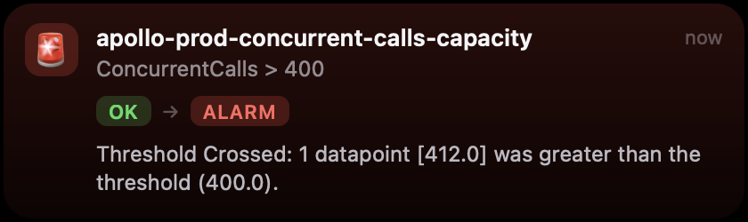

# Houston 🛰️

> *Houston, we have a notch.*

Mission control that lives in your MacBook notch. When something breaks in
prod, Houston peeks out to tell you. When nothing's broken, it keeps quiet.

It's a Dynamic-Island style notification area for macOS, written in Rust with
tao, wry and tray-icon. It shows CloudWatch alarms, Security Hub findings and
anything else that can post JSON, and new sources plug in behind one small
trait.



## Quick start

You need macOS 12 or later and a Rust toolchain (1.88 or later, for let
chains). The AWS CLI v2 is needed only for the AWS sources.

```bash
git clone https://github.com/rhamnett/houston.git
cd houston
cargo run --release
```

A drill (the demo) plays a second after launch. Hover the notch to expand it.
Then send your first transmission from another terminal:

```bash
scripts/houston "Houston, we have a problem" "it's only a test" warning
```

To point it at real alarms, edit
`~/Library/Application Support/houston/config.json` (created on first run;
**Open config folder** in the menu takes you there), turn on a source and
restart. See [Sources](#sources-the-plug-in-seam).

## What it does

- A new notification **peeks**: it grows out of the notch as a card for 4–8 s
  (longer for higher severity), then collapses.
- **Compact**: the island shows the most urgent notification's icon on the
  left of the notch and a short value on the right (`ALARM`, `62%`, `87%`,
  `05:12`), plus `+N` for the rest. Critical alarms make it glow red.
- **Hover** the notch to expand every notification, with buttons. Move away
  and it collapses. The window is click-through at all other times.
- On Macs without a notch it draws a black pill in the same place.

The menu bar icon shows how many warnings and criticals are active. Its menu
has **Run a drill** (the demos), **Radio silence** (do not disturb: no peeks,
no sounds), **Clear the board**, **Copy API token** and **Open config folder**.

### Mission vocabulary

| You'll see             | It means                                    |
|------------------------|---------------------------------------------|
| All systems nominal    | nothing is active                           |
| Lost signal from …     | AWS credentials expired or the call failed  |
| Radio silence          | do not disturb                              |
| Drill                  | the demo                                    |
| Capcom                 | the sender of the demo on-call message      |
| Splashdown             | quit                                        |

The alarm cards themselves stay plain: an alarm should never need decoding.

## Notification types

Every source produces the same `Island` (`src/island.rs`). `kind` selects the
body:

| kind       | shows                                              | compact      |
|------------|----------------------------------------------------|--------------|
| `alert`    | state chips `OK → ALARM`, reason, fields           | `ALARM`      |
| `progress` | animated bar and percent (`value` 0–1)             | ring + `42%` |
| `metric`   | big value, sparkline of `series`, dashed threshold | `87%`        |
| `message`  | sender and body                                    | `compact`    |
| `timer`    | live clock since `started_at` (unix ms)            | `05:12`      |

Common fields: `key` (posting the same key again updates in place), `title`,
`subtitle`, `body`, `icon` (an emoji), `severity` (`success` `info` `warning`
`critical`), `compact`, `fields` (label/value rows), `actions` (up to 3
buttons), `sticky` (stays until dismissed), `ttl_secs` (default 15),
`revision` and `silent`.

- **Actions**: `dismiss` and `snooze` (with `snooze_mins`) are handled by the
  app, and an action with a `url` opens it. Any other id goes back to the
  source that posted the island.
- **`revision`**: a dismissed island stays hidden while its source keeps
  re-posting the same revision. Poll sources rely on this.
- **`silent`**: updates in place without a peek or a sound, for progress ticks
  and live metrics.

## Drills (the demo)

The full drill plays a second after launch (turn it off with `demo.autoplay`).
Replay it from **Run a drill** in the menu, or from the empty expanded island.
In order:

1. A CloudWatch alarm, built through the same mapper the real sources use.
   **Acknowledge** is a round trip back to the source.
2. A deploy with progress, ending in a success.
3. A live RDS CPU metric with a sparkline and threshold.
4. An on-call message from Capcom.
5. A SEV-2 incident timer with Acknowledge and Resolve.
6. The alarm going back to OK.

## Sources (the plug-in seam)

`src/source.rs`:

```rust
pub trait Source: Send + 'static {
    fn id(&self) -> String;
    fn run(self: Box<Self>, sink: Sink, inbox: Receiver<Inbound>);
}
```

Each source runs on its own thread. It calls `sink.upsert(island)`,
`sink.remove(key)` and `sink.status(text)`, and receives `Inbound::Action`
(button presses) and `Inbound::Trigger` on its inbox. To add one, write a
module in `src/sources/` and add it to `sources::from_config`. The UI, store,
peek logic and sounds need no changes.

Built in:

| source       | what it does                                                       | default |
|--------------|--------------------------------------------------------------------|---------|
| `demo`       | sample islands of every kind                                       | on      |
| `api`        | HTTP on `127.0.0.1:7878`                                           | on      |
| `cloudwatch` | polls `describe-alarms --state-value ALARM` per profile and region | off     |
| `sqs`        | long-polls an SQS queue fed by EventBridge or SNS                  | off     |
| `iot`        | **stub**: AWS IoT Core MQTT subscriber (live call events)          | off     |

The AWS sources shell out to the `aws` CLI, so SSO profiles and credential
processes work unchanged. When an SSO session expires, an island tells you to
run `aws sso login --profile …`. `src/aws.rs` maps three payload shapes to the
same alarm island: `describe-alarms` rows, EventBridge
`CloudWatch Alarm State Change` events, and SNS alarm notifications (raw or in
an SNS envelope). It also maps Security Hub findings (`Security Hub Findings -
Imported`, raw or in an SNS envelope) to one island per finding.

### Local API: radio Houston

```bash
scripts/houston "Build finished" "web · main · 4m12s" success
scripts/houston --json '{"key":"deploy","title":"Deploying","kind":{"type":"progress","value":0.4},"silent":true}'
scripts/houston --remove deploy
```

The endpoints are below. Every one except health needs
`Authorization: Bearer <api.token>` (generated on first run; **Copy API token**
puts it on the clipboard).

- `GET /v1/health`
- `POST /v1/islands`: an island as JSON
- `DELETE /v1/islands/{key}`
- `POST /v1/aws/alarm`: an EventBridge or SNS CloudWatch alarm payload, or a
  Security Hub findings event

### CloudWatch, polling

In `~/Library/Application Support/houston/config.json`:

```json
"cloudwatch": {
  "enabled": true,
  "interval_secs": 60,
  "accounts": [
    { "profile": "prod", "region": "eu-west-2", "label": "prod" },
    { "profile": "staging", "region": "eu-west-2", "alarm_prefix": "api-" }
  ]
}
```

- An alarm that enters ALARM appears as a sticky critical island, with
  **Console ↗** and **Snooze 1h**.
- An alarm that leaves ALARM gets a 20-second OK island.
- A dismissed alarm stays hidden until its state changes again.
- This needs only `cloudwatch:DescribeAlarms`.

### CloudWatch, pushed through SQS (multi-account)

For many accounts, or to get alarms within seconds without polling:

1. Create an SQS queue in one account.
2. In each account, add an EventBridge rule matching
   `{"source":["aws.cloudwatch"],"detail-type":["CloudWatch Alarm State Change"]}`.
   Target the queue directly, or forward to a central event bus first.
   Existing SNS alarm topics can subscribe the queue instead.
3. Set the queue in the config:

```json
"sqs": { "enabled": true, "queue_url": "https://sqs.eu-west-2.amazonaws.com/123456789012/houston", "profile": "ops", "region": "eu-west-2" }
```

A message body can also be an island JSON, so a Lambda, a pipeline or anything
else that can write to SQS can post custom notifications. Messages are deleted
after they are shown. This needs `sqs:ReceiveMessage` and `sqs:DeleteMessage`.

Sources are read at startup, so restart after changing them.

### Alarm rules

By default every alarm in ALARM is a sticky critical. `alarm_rules` changes
that per alarm name, for every source. `pattern` uses `*` as a wildcard, and
the first matching rule wins, so put specific patterns first:

```json
"alarm_rules": [
  { "pattern": "apollo-prod-concurrent-calls-capacity", "severity": "critical",
    "runbook_url": "https://github.com/…/docs/runbooks/capacity.md" },
  { "pattern": "apollo-prod-eks-*", "severity": "warning" },
  { "pattern": "apollo-prod-billing-*", "severity": "info", "silent": true },
  { "pattern": "*langfuse*", "mute": true }
]
```

- `severity`: `critical`, `warning`, `info` or `success`, while in ALARM.
- `sticky`: defaults to true for critical. Other alarms stay for 5 minutes.
- `silent`: update without a peek or a sound.
- `mute`: drop the alarm.
- `runbook_url`: adds a **Runbook ↗** button.

### AWS IoT Core (stub)

`src/sources/iot.rs` has the config and the mapping, but no MQTT client yet.
When enabled it only reports "not implemented yet" in the status line. The
mapping turns Apollo's live call events (`apollo/<env>/t/<tenant>/call/<id>/events`)
into one timer island per call, which goes away on `call.ended`:

```json
"iot": { "enabled": false, "endpoint": "abc123-ats.iot.eu-west-2.amazonaws.com",
         "profile": "apollo-prod", "region": "eu-west-2",
         "topics": ["apollo/prod/t/+/call/+/events"] }
```

### Apollo (sip) prod

`examples/apollo-prod.json` has every Apollo route set up but turned off, and
a first draft of `alarm_rules`. Copy the parts you want into your config.

- **Polling** works as soon as `cloudwatch.enabled` is true and
  `aws sso login --profile apollo-prod` has been run.
- **SQS** needs a queue that doesn't exist yet. In sip, subscribe one to the
  `apollo-prod-alarms` topic (and `security-incidents` for findings) next to
  `AlarmSlackNotifyConstruct`, with `rawMessageDelivery` off.
- **IoT** needs the MQTT client in `iot.rs`, and an IAM role with
  `iot:Connect`, `iot:Subscribe` and `iot:Receive` on the topic filter.

## Install and launch at login

```bash
./bundle.sh            # writes dist/Houston.app (ad-hoc signed, this machine only)
open "dist/Houston.app"
```

Then add it under System Settings > General > Login Items.

## Logs

`~/Library/Logs/houston.log` when started from Finder or as a login item;
the terminal otherwise.

## Layout

- `src/main.rs`: event loop, tray menu, peek and hover state, action routing
- `src/island.rs`: the notification model and validation
- `src/store.rs`: active islands, expiry, snooze, dismissal, ordering
- `src/source.rs`: the `Source` trait, `Sink` and `Registry`
- `src/sources/`: `demo`, `local_api`, `cloudwatch`, `sqs`, `iot` (stub)
- `src/aws.rs`: the AWS CLI runner, the alarm and findings mappers, alarm rules
- `src/overlay.rs`: the overlay window and the island page (HTML/CSS/JS)
- `src/notch.rs`: notch geometry, window level and Spaces, the hover monitor
- `src/config.rs`, `src/icon.rs`, `src/notify.rs`, `src/log.rs`

## Development

```bash
cargo test                    # mappers, store, rules, config
cargo clippy --all-targets    # kept warning-free
cargo fmt
```

New source? Add a module in `src/sources/`, implement `Source`, register it in
`sources::from_config` and give it a config block in `src/config.rs`.
`sources/iot.rs` is a good small example of the shape.

## Known limits

- Clicking a button brings the app forward, so the app you were in loses focus
  until you click back. A non-activating `NSPanel` would avoid this.
- Display changes are picked up within 3 s.
- The IoT source is a stub: the config and mapping are there, but there's no
  MQTT client yet.
- Not affiliated with Notchy; this is a from-scratch take on the idea.
  Not affiliated with NASA either, sadly.
